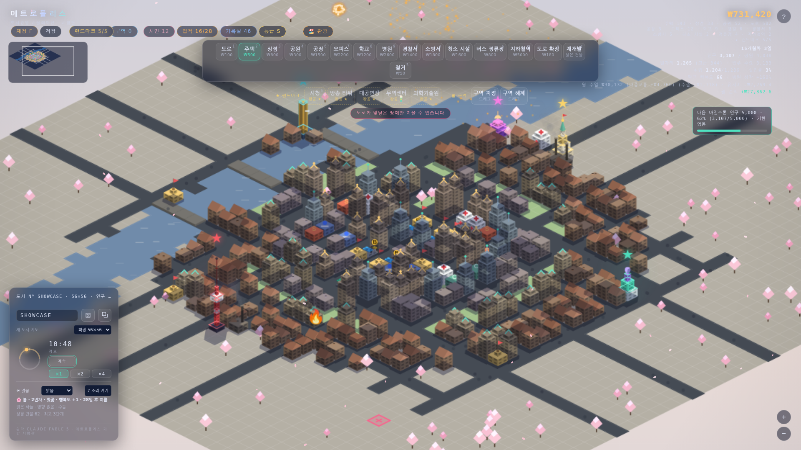
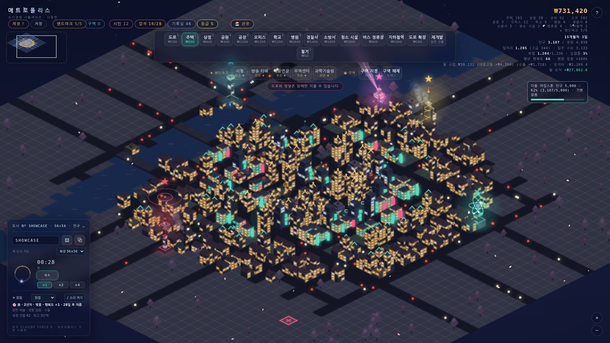
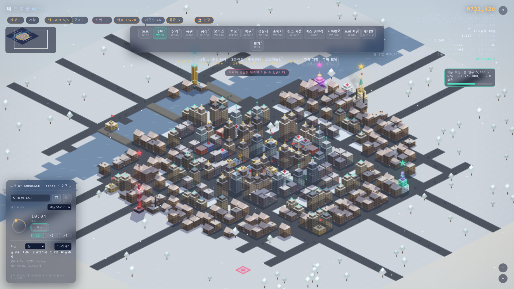
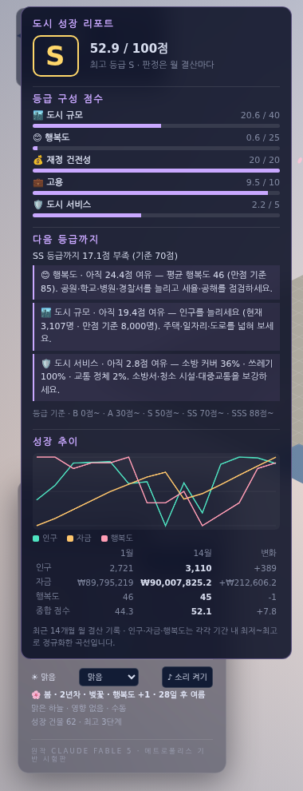
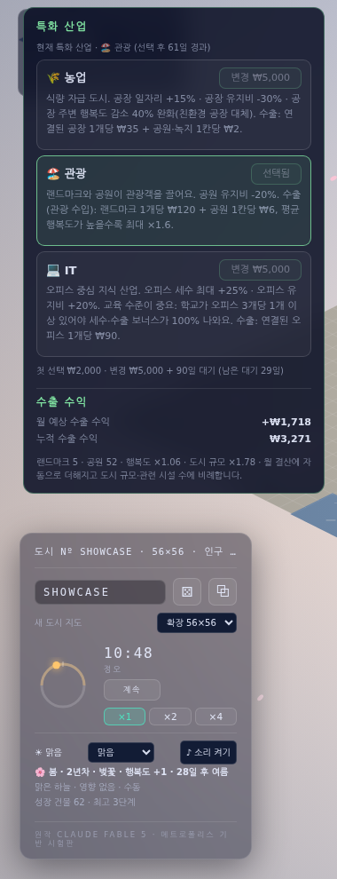
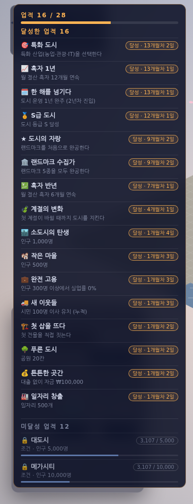
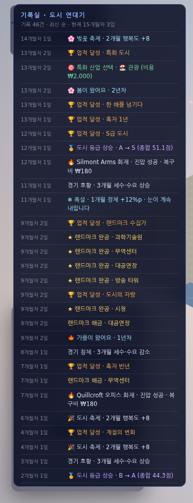

<div align="center">

# 🏙️ 메트로폴리스 · 도시경영 시뮬레이션

[](https://sigco3111.github.io/metropolis-city-builder/)


**등각투영(Isometric) 도시 위에 도로를 깔고, 집과 일터를 세우고, 도시의 살림까지 책임지는 브라우저 도시경영 게임**

설치 없이 브라우저에서 바로 · 단일 `index.html` · 한글 UI · 엔딩 없는 엔드리스 플레이

### 👉 [지금 플레이하기](https://sigco3111.github.io/metropolis-city-builder/) 👈

`https://sigco3111.github.io/metropolis-city-builder/`

<br>

<a href="https://sigco3111.github.io/metropolis-city-builder/">
  
</a>

<sub>벚꽃 핀 봄의 메트로폴리스 · S급 도시 · 인구 3천 명 · 랜드마크 5종 완공</sub>

</div>

---

## 📖 목차

1. [게임 소개](#-게임-소개)
2. [스크린샷](#-스크린샷)
3. [빠르게 시작하기](#-빠르게-시작하기)
4. [플레이 방법](#%EF%B8%8F-플레이-방법)
5. [전체 기능](#-전체-기능)
6. [조작법 · 단축키](#%EF%B8%8F-조작법--단축키)
7. [등급 체계와 특화 산업 수치표](#-등급-체계와-특화-산업-수치표)
8. [기술 스택](#%EF%B8%8F-기술-스택)
9. [저장소 구성 · 로컬 실행](#-저장소-구성--로컬-실행)
10. [출처](#-출처)

---

## 🎮 게임 소개

메트로폴리스는 빈 땅에서 시작해 작은 마을을 대도시로 키우는 **도시경영 게임**입니다. 낮과 밤이 흐르고 계절과 날씨가 바뀌는 등각투영 도시 위에서, 도로와 주택·상점·공장·오피스를 지어 시민을 맞이하고, 세금과 대출을 조절해 재정을 꾸리고, 소방·청소·대중교통으로 도시를 지키고, 랜드마크와 특화 산업으로 도시의 개성을 만들어 갑니다.

- 🚫 **엔딩 없음** – 인구 마일스톤(500 · 1,000 · 2,000 · 5,000 · 10,000명)은 축하만 하고 도시는 계속됩니다. 단, 재정이 무너지면 **파산 게임오버**가 기다립니다.
- 🧠 **살아 있는 시뮬레이션** – 시민은 청년·장년·노년으로 나뉘고, 일자리·행복도·세율·서비스·사건에 따라 이사 들어오고 떠납니다.
- 🏅 **성장의 보상** – 업적 28종, 기록실(도시 연대기), 도시 등급(B ~ SSS), 특화 산업과 수출 수익이 장기 목표가 됩니다.
- 💾 **언제든 이어서** – 자동 저장과 수동 슬롯 3개. 새로고침해도 도시가 그대로 남습니다.

---

## 📸 스크린샷

> 확장 지도(56×56)에서 키운 도시입니다. 관광 특화 · S등급 · 랜드마크 5종 완공 상태.

<table>
  <tr>
    <td align="center" width="50%"><br><b>🌃 야경</b><br><sub>창문 불빛 · 네온 사인 · 랜드마크 조명</sub></td>
    <td align="center" width="50%"><br><b>❄️ 겨울 · 눈</b><br><sub>눈 덮인 도시와 얼어붙은 강</sub></td>
  </tr>
</table>

<table>
  <tr>
    <td align="center" width="25%"><br><b>🏅 성장 리포트</b></td>
    <td align="center" width="25%"><br><b>🌾 특화 산업</b></td>
    <td align="center" width="25%"><br><b>🏆 업적</b></td>
    <td align="center" width="25%"><br><b>📜 기록실</b></td>
  </tr>
</table>

---

## 🚀 빠르게 시작하기

1. **[플레이 링크](https://sigco3111.github.io/metropolis-city-builder/)** 를 엽니다. (PC 브라우저 권장)
2. 도구 막대에서 **도로(1)** 를 고르고 빈 땅에 길을 깝니다.
3. 도로와 맞닿은 땅에 **주택(2)** 과 **상점(3)** 을 짓습니다. 곧 주민이 입주합니다.
4. 일자리를 위해 **공장(6)** · **오피스(7)** 를 더하고, **공원(4)** · **학교(8)** 로 행복도를 챙깁니다.
5. 월 결산(30일마다)을 보며 세율을 조절하고, 상단의 **등급 · 특화 산업** 버튼으로 도시의 성장 방향을 정해 보세요.

---

## 🕹️ 플레이 방법

| 단계 | 할 일 | 팁 |
|---|---|---|
| 🏗️ 건설 | 도구를 고르고 빈 땅을 클릭 | 주택·상점·공장·오피스는 **도로와 맞닿은 땅**에만 지을 수 있어요 |
| 👥 입주 | 도로에 연결된 주택에 주민이 입주 | 입주 수요는 일자리 수·행복도·세율에 좌우됩니다 |
| 💼 일자리 | 상점·공장·오피스가 일자리를 만듦 | 실업과 빈 일자리가 균형을 이루면 수요가 건강해요 |
| 💰 재정 | 매달 세금 수입 − 유지비 − 대출 상환 | 적자가 이어지면 파산합니다. `F` 로 재정 패널을 엽니다 |
| 😊 행복도 | 학교·병원·경찰서·공원은 ↑, 공장은 ↓ | 행복도가 높을수록 입주가 늘고 세금이 커져요 |
| 🛡️ 서비스 | 소방·청소·대중교통 확충 | 화재·쓰레기·교통 정체를 막아 줍니다 |
| 🏛️ 성장 | 랜드마크 해금, 특화 산업 선택, 등급 올리기 | 업적과 기록실에 성과가 남아요 |

**파산 조건**: 자금이 **-₩5,000** 아래로 떨어지거나, 결산 후 자금이 **3개월 연속 0 미만**(대출 한도를 모두 쓴 상태라면 **2개월**)이면 게임오버입니다. 파산 위기를 넘기면 업적 '위기 극복'이 기록됩니다.

---

## ✨ 전체 기능

### 🏗️ 1. 건설 · 구역 · 랜드마크

- **기본 건설 도구**: 도로 · 주택 · 상점 · 공원 · 철거, 그리고 공장 · 오피스 · 학교 · 병원 · 경찰서 (숫자 키 `1`–`0`)
- **도시 서비스 시설**: 소방서(`S`) · 청소 시설(`C`) · 버스 정류장(`B`) · 지하철역(`M`) · 도로 확장(`U`)
- **랜드마크 5종** – 조건을 채우면 해금, 완공하면 도시 전체에 버프
  | 랜드마크 | 키 | 효과 | 해금 조건 |
  |---|:-:|---|---|
  | 🏛️ 시청 | `H` | 모든 세수 +10% | 인구 1,000 |
  | 📡 방송 타워 | `T` | 모든 주택 행복도 +5 | 인구 2,500 |
  | 🎭 대공연장 | `V` | 상업 세수 +15% | 인구 1,500 · 평균 행복도 60 |
  | 🏢 무역센터 | `X` | 오피스 일자리 +30% | 누적 세수 ₩150,000 · 오피스 2개 |
  | 🔬 과학기술원 | `L` | 입주 수요 +10% | 학교 2개 · 오피스 3개 |
- **구역(Z)**: 지도를 드래그해 영역을 묶고 이름을 붙입니다. 구역 패널에서 구역별 **인구 · 건물 · 행복도 · 세수 · 정체**를 보고, 색상 표시를 켜고 끌 수 있어요. 구역 해제는 `J`. 같은 이름이면 기존 구역이 넓어집니다.
- **두 가지 지도 크기**: 기본 **40×40**, 확장 **56×56**(면적 약 2배). 시드(`⚄`)로 강과 도로가 다른 새 도시를 만들 수 있고, 왼쪽 위 **미니맵** 클릭·드래그로 이동합니다.
- **건물 성장**: 도로에 연결된 주택·상점·오피스가 인구·행복도·입주 조건을 10일 유지하면 외형이 **기본 → 성장 → 번영** 3단계로 자랍니다(2단계 인구 220 · 행복도 48, 3단계 인구 650 · 행복도 58).

### 🚇 2. 교통

- 도로 용량을 넘는 차량이 몰리면 **교통 정체**가 생기고 상업 수입과 행복도가 떨어집니다.
- **버스 정류장**(반경 5칸 · 차량 부하 -20%)과 **지하철역**(반경 10칸 · -45%)이 정체를 줄이고 **요금 수입**을 만듭니다. 지하철역이 2개 이상이면 **노선망 효과**가 붙어요.
- **도로 확장**으로 기존 도로 용량을 2배로 늘립니다(추가 유지비 ₩2/월).

### 💰 3. 재정

- **월 결산**(30일마다): 세금 수입 · 유지비 · 대출 상환 · 복구비를 정산하고 순익을 알려 줍니다.
- **재정 패널(F)**: 최근 12개월 수입·지출 막대 그래프, 이번 달 세수 내역(주거/상업/산업), 대중교통·서비스 비용.
- **세율 조정**: 주거 · 상업 · 산업 세율을 따로 조절. 세율이 높으면 세수는 늘지만 행복도와 일자리 수요가 떨어집니다.
- **대출**: ₩10,000 단위, 최대 ₩50,000, 월 이자 1%(연 12%), 12개월 분할 상환. 조기 상환 가능.
- **수출 수익**: 특화 산업을 정하면 월 결산에 수출 수익이 더해집니다(아래 참고).

### 🚒 4. 도시 서비스 · 사건

- **소방서**: 반경 6칸 화재 위험 감소. 소방 범위 밖 건물은 화재로 잃을 확률이 훨씬 높아요(복구비 발생).
- **청소 시설**: 800명당 1개가 필요하며 부족하면 쓰레기로 행복도가 떨어집니다.
- **도시 사건**: 화재, 경기 **호황 / 침체**, **축제**(행복도↑), **전염병**(병원 범위 밖 행복도↓·수요↓) 등이 월 결산 때 발생하며 도시 서비스 패널에 로그로 남습니다.

### 🌦️ 5. 날씨 · 계절 · 시간

- **낮밤 주기**(90초/일), 야경의 창문 불빛과 그림자, 왼쪽 아래 다이얼로 시간대를 직접 돌려 볼 수 있어요.
- **날씨**: 맑음 · 비 · 눈. 자동은 12일마다 순환하고 직접 고를 수도 있습니다(비 정체 +3%p, 눈 정체 +5%p와 행복도 -1).
- **계절**: 봄 · 여름 · 가을 · 겨울(계절당 90일). 계절마다 분위기와 행복도 보정이 달라지고, 봄 벚꽃 · 겨울 눈보라 등 계절 이벤트가 있습니다.
- **시간 속도**: ×1 · ×2 · ×4, 스페이스로 일시정지.
- **사운드**: 잔잔한 합성음과 건설·사건 효과음(기본 꺼짐, `소리 켜기` 버튼으로 켜기).

<p align="center">
  
  
</p>


### 🧑‍🤝‍🧑 6. 시민

- 시민은 **청년 · 장년 · 노년**으로 나뉘며, 직업은 **상업 · 산업 · 오피스** 일자리를 채웁니다. 취업 가능 인구 · 실업률 · 빈 일자리가 HUD에 표시돼요.
- **대표 시민**: 이름표가 붙은 대표 시민들이 시민 패널에 등장하고, 도시 상태(세율 · 일자리 · 행복도 · 서비스 · 사건)에 따라 정해지는 **이사 사유**가 기록됩니다.
- 건물에 마우스를 올리면 입주 인원 · 행복도(주변 영향 내역) 등을 볼 수 있어요.

### 🏆 7. 업적 · 기록실

- **업적 28종**: 인구 · 흑자 · 행복도 · 랜드마크 · 지하철 · 공원 · 완전 고용 · 안전 도시 · 구역 · 재개발 · **S급 도시 · 특화 도시 · 수출 강국** 등. 달성 시 알림이 뜨고 진행도가 막대로 표시됩니다.
- **기록실(도시 연대기)**: 도시 시작, 첫 건물, 인구 마일스톤, 업적, 계절·사건, 랜드마크, 재정 위기, 재개발, **등급 변동, 특화 산업 선택·변경**까지 주요 순간이 게임 내 날짜와 함께 최신 순으로 쌓입니다.

<p align="center">
  
  &nbsp;&nbsp;
  
</p>

### 🔨 8. 재개발 · 노후화

- 건설 후 약 **9개월(270일)** 이 지나면 건물이 **낡음** 상태가 되어 외관이 탁해지고 행복도 -6 · 정원 -8% · 일자리 -8%.
- **재개발 도구(`R`)**: 낡은 건물을 클릭하면 철거+신축 비용의 **1.15배**로 **한 단계 높은 신식 건물**로 즉시 재건축됩니다.
- **구역 일괄 재개발**: 구역 패널에서 총비용을 확인하고 구역 안의 낡은 건물을 한 번에 새로 짓습니다.
- 재개발 중 주민이 임시로 이사했다가 돌아오기도 하고, 재개발 역사는 기록실에 남습니다.

### 🏅 9. 도시 랭킹 (등급 B ~ SSS) · 성장 리포트

- **도시 등급**: 규모 · 행복도 · 재정 · 고용 · 서비스를 100점 만점으로 환산해 **B / A / S / SS / SSS** 등급을 부여합니다. 현재 등급은 상단 **`등급 ○`** 버튼에 색과 함께 표시돼요.
- **등급 변동 알림**: 월 결산 때 등급이 바뀌면 알림이 뜨고 **기록실에 기록**됩니다. (S급 도시 업적 연동)
- **성장 리포트 패널**: 종합 점수와 등급 배지, 항목별 점수(예: 규모 14.5 / 40), **다음 등급까지 부족한 점수와 개선 팁**, 최근 36개월 **인구 · 자금 · 행복도 추이 그래프**와 변화 표를 보여 줍니다.

<p align="center">
  
</p>

### 🌾 10. 특화 산업 · 수출 수익

상단 **`특화 산업`** 버튼에서 도시의 주력 산업을 하나 고릅니다. 첫 선택은 **₩2,000**, 변경은 **₩5,000 + 90일 대기**.

| 산업 | 효과 | 수출 수익 (월) |
|---|---|---|
| 🌾 **농업** | 공장 일자리 +15% · 공장 유지비 -30% · 공장 주변 행복도 하락 40% 완화(식량 자급, 친환경 공장 대체) | 연결된 공장 1개당 ₩35 + 공원·녹지 1칸당 ₩2 |
| 🏖️ **관광** | 공원 유지비 -20% · 랜드마크와 공원이 관광 수입을 만들고 **행복도에 연동**(×0.6 ~ ×1.6) | 랜드마크 1개당 ₩120 + 공원 1칸당 ₩6 |
| 💻 **IT** | 오피스 세수 최대 +25% · 오피스 유지비 +20% · **높은 교육 요구**: 학교가 오피스 3개당 1개 이상이어야 보너스 100% | 연결된 오피스 1개당 ₩90 |

- 수출 수익은 위 시설 수에 **도시 규모 보정**(`1 + 인구/4000`, 인구 10,000명에서 상한)을 곱해 월 결산에 **'수출 수익'** 으로 더해지고, 상단 HUD 월 수입에도 `(수출 +₩…)` 로 표시됩니다.
- 업적 연동: **특화 도시**(산업 선택) · **수출 강국**(누적 수출 수익 ₩50,000). 선택·변경은 기록실에 남습니다.

<p align="center">
  
</p>

### 💾 11. 저장 · 불러오기

- **자동 저장** + **수동 슬롯 3개** (브라우저 `localStorage`, 상단 `저장` 버튼).
- 도시 지형 · 건물 · 구역 · 자금 · 대출 · 세율 · 시민 · 업적 · 기록실 · 날씨 · 시간에 더해 **도시 등급 · 성장 추이 · 특화 산업 · 수출 누적**까지 함께 저장됩니다.
- **하위 호환**: 등급·특화 산업이 없던 이전 버전 저장도 그대로 불러오고, 없는 항목은 기본값으로 시작합니다.
- 시드가 담긴 **공유 링크 복사**(`⧉`)로 같은 지형을 친구와 공유할 수 있어요.

---

## ⌨️ 조작법 · 단축키

### 🖱️ 마우스 · 화면

| 조작 | 동작 |
|---|---|
| 클릭 | 선택한 도구로 건설 / 철거 |
| 드래그 | 화면 이동 (구역 도구 사용 중엔 우클릭 드래그) |
| 휠 · `+` · `-` | 확대 / 축소 |
| 미니맵 클릭·드래그 | 빠른 이동 |
| 다이얼 드래그 | 시간대 변경 (낮 ↔ 야경) |
| 건물에 마우스 올리기 | 이름표 · 입주 · 행복도 정보 |

### ⌨️ 키보드

| 키 | 기능 | 키 | 기능 |
|:-:|---|:-:|---|
| `1` | 도로 | `S` | 소방서 |
| `2` | 주택 | `C` | 청소 시설 |
| `3` | 상점 | `B` | 버스 정류장 |
| `4` | 공원 | `M` | 지하철역 |
| `5` | 철거 | `U` | 도로 확장 |
| `6` | 공장 | `H` | 시청 |
| `7` | 오피스 | `T` | 방송 타워 |
| `8` | 학교 | `V` | 대공연장 |
| `9` | 병원 | `X` | 무역센터 |
| `0` | 경찰서 | `L` | 과학기술원 |
| `Z` | 구역 지정 | `J` | 구역 해제 |
| `R` | 재개발 | `F` | 재정 패널 |
| `Space` | 일시정지 / 계속 | `?` | 도움말 |
| `Esc` | 도움말 닫기 | | |

> 상단 버튼: `저장` · `재정(F)` · `랜드마크` · `구역` · `시민` · `업적` · `기록실` · **`등급`** · **`특화 산업`**. 패널은 서로 열면 이전 패널이 자동으로 닫힙니다.

---

## 📊 등급 체계와 특화 산업 수치표

### 🏅 도시 등급 점수 (100점 만점)

| 항목 | 만점 | 계산 |
|---|:-:|---|
| 🏙️ 도시 규모 | 40 | 인구 8,000명에서 만점 (`40 × (인구/8000)^0.7`) |
| 😊 행복도 | 25 | 평균 행복도 45 → 0점, 85 → 25점 (인구 100명 이상부터) |
| 💰 재정 건전성 | 20 | 흑자 연속 개월(12개월 8점) + 대출 없이 보유 자금(₩100,000 7점) + 대출 부담 없음(5점) |
| 💼 고용 | 10 | 실업률이 낮을수록 (취업 가능 인구 20명 이상부터) |
| 🛡️ 도시 서비스 | 5 | 소방 커버 · 쓰레기 처리 · 교통 정체 |

| 등급 | B | A | S | SS | SSS |
|---|:-:|:-:|:-:|:-:|:-:|
| 필요 점수 | 0 ~ | 30 ~ | 50 ~ | 70 ~ | 88 ~ |

### 🌾 특화 산업 한눈에

| | 농업 | 관광 | IT |
|---|---|---|---|
| 핵심 | 공장 중심 | 랜드마크 · 공원 | 오피스 · 학교 |
| 유지비 | 공장 -30% | 공원 -20% | 오피스 +20% |
| 특수 효과 | 공장 일자리 +15%, 공장 행복도 하락 완화 | 행복도 연동 ×0.6 ~ ×1.6 | 오피스 세수 +25%, 교육 충족 필요 |
| 수출 단가 | 공장 ₩35 · 녹지 ₩2 | 랜드마크 ₩120 · 공원 ₩6 | 오피스 ₩90 |

---

## 🛠️ 기술 스택

- **HTML5 · CSS3 · Vanilla JavaScript** – 프레임워크와 빌드 과정 없이 **단일 `index.html`** 하나로 동작
- **Canvas 2D** – 등각투영 렌더러(정적 레이어 + 동적 레이어), 낮밤·그림자·창문 불빛, 날씨 파티클
- **Web Audio API** – 합성음 사운드
- **localStorage** – 자동 저장 · 슬롯 저장(버전 필드로 하위 호환)
- **시드 기반 절차적 생성** – 같은 시드는 같은 강과 도로 지형
- **GitHub Pages** – 정적 배포

---

## 📁 저장소 구성 · 로컬 실행

```
metropolis-city-builder/
├── index.html      # 게임 전체 (HTML + CSS + JS)
├── README.md       # 이 문서
└── screenshots/    # README용 게임 스크린샷
```

로컬에서 실행하려면 저장소를 내려받아 `index.html` 을 브라우저로 열면 됩니다. (별도 설치 · 서버 불필요)

```bash
git clone https://github.com/sigco3111/metropolis-city-builder.git
cd metropolis-city-builder
# index.html 을 브라우저로 열기
```

---

## 🙏 출처

[sigco3111/FABLE-SHOWCASE](https://github.com/sigco3111/FABLE-SHOWCASE) 의 `metropolis`(Claude Fable 5 제작)를 바탕으로, 등각투영 렌더링(낮밤 · 창문 불빛 · 그림자)은 그대로 쓰고 도시경영 시뮬레이션(건설 · 재정 · 시민 · 서비스 · 업적 · 재개발 · 랭킹 · 특화 산업 등)을 더해 확장했습니다. 원본 저장소에는 LICENSE 파일이 없습니다.

<div align="center">

🏙️ **작은 마을에서 SSS급 대도시까지 — 당신의 도시를 키워 보세요!** 🏙️

</div>
